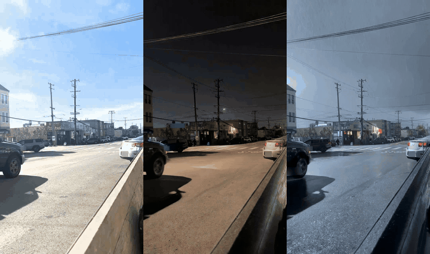
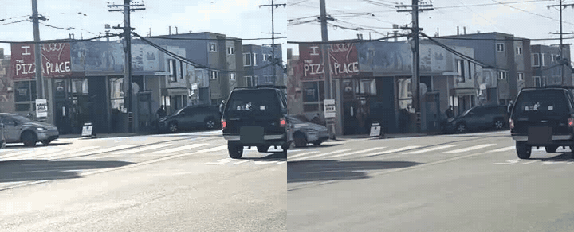
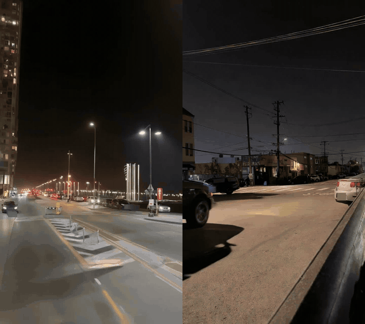
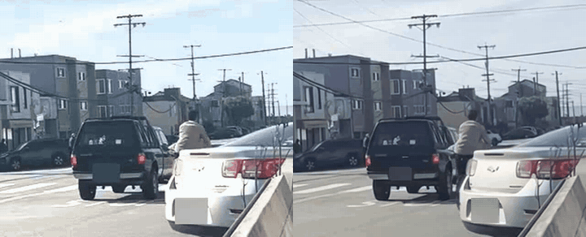

# Cosmos 3 Nano: A Hands-On Test from a Product Marketing Perspective

I took a 22-second phone video of a busy street and ran it through NVIDIA Cosmos 3 Nano, using NVIDIA's own example scripts with small, documented edits. The question: can a unified World Foundation Model understand a physical scene, simulate the rare edge cases a team doesn't have footage of (night, rain, a cyclist cutting in), and then check its own output?

**Short answer:** Simulating new conditions on my own footage worked well: my street at night in about 6 minutes on one GPU, and falling rain once one default was changed. Scene understanding was accurate, from captions and timelines to reading actual sign text. Self-checking needs more work: the Reasoner correctly passed the clean clips but didn't catch one subtle error, a second cyclist appearing out of nowhere. Following small moving objects over time is where I'd focus next.

<p align="center">
  <a href="clips/generated/"></a>
  <br>
  <sub><b>Left:</b> my original footage. <b>Middle:</b> night (edge guidance 3.0). <b>Right:</b> rain (test A, edited avoid list). Same 4 seconds, about 6 minutes per clip on one GPU. Click for the full-quality clips.</sub>
</p>

<!-- TODO: demo video link (60 to 90 s) -->

## Setup

- **Hardware:** one NVIDIA RTX PRO 6000 Blackwell (96 GB), rented on Brev at $4.08/hr
- **Model:** Cosmos 3 Nano through the NIM container `nvcr.io/nim/nvidia/cosmos3:2.1.0`. On this GPU the container picked the precision by itself: FP8 (8-bit) for the Generator and NVFP4 (4-bit) for the Reasoner. Every result here is for those settings on one RTX PRO 6000.
- **Code:** [NVIDIA/cosmos-framework](https://github.com/NVIDIA/cosmos-framework) at commit `1f17379`, example scripts `v2v.py`, `transfer.py` and `reasoner.py`
- **Input:** a fixed-camera, vertical (720 x 1280) street video with cars, cyclists and pedestrians
- **Sessions:** Nov 14 to 15 and Nov 19, 2026. $20.88 of GPU time in total, from Brev billing ($14.86 for Nov 14 to 15, $6.02 for Nov 19).

## The experiment

### Why this matters

NVIDIA positions Cosmos 3 as a unified World Foundation Model that can both understand video (reasoning) and generate it (simulation). For autonomous-vehicle (AV) and robotics teams, that promises a closed-loop synthetic data pipeline: take footage you already have, generate the rare edge cases you're missing, and let the same model check whether the generated clips make physical sense. I tested each step of that loop on footage a team would actually have: one phone video of a busy street, not NVIDIA's curated samples.

### How I tested

- **One source video, with an answer key.** From the 22-second video I cut a 10-second window (0:10 to 0:20). The model sees the first 7 seconds; the last 3 seconds are held back as the ground-truth answer, so I can compare the model's continuation or prediction with what actually happened.
- **NVIDIA's own scripts and questions.** I used NVIDIA's official example scripts and, where NVIDIA has one, its own question for the job (for example its plausibility question). My edits only point them at my clip; see [What I changed](#what-i-changed-in-nvidias-code).
- **One change at a time.** When a result wasn't good enough, I changed one setting and reran, so each difference has one cause.
- **My own viewing as the reference.** I watched every clip and checked every answer against the actual output files, frame by frame where it mattered.
- **Settings used throughout:** video pruning off (`NIM_VIDEO_PRUNING_RATE=0`, the setting NVIDIA validated its Reasoner cases with), a larger pixel budget for Reasoner video cases (so the model sees enough detail; more in [`CHANGES.md`](CHANGES.md)), and fixed seeds so every run can be repeated.

### Experiment 1: Continuations (v2v.py)

- **Question:** can the model continue my first 7 seconds realistically, simulating prompted edge cases?
- **Input:** the first 7 seconds of the 10-second window (0:10 to 0:17).
- **What I tested:** four prompts: normal traffic, a pedestrian stepping in front of a car, a cyclist weaving through traffic, and heavy rain starting. Each also says the camera is fixed.
- **How I checked:** watched each one against the actual next 3 seconds.

<p align="center">
  <a href="clips/generated/continuations/street_pedestrian.mp4"></a>
  <br>
  <sub><b>Left:</b> what actually happened in the next 3 seconds. <b>Right:</b> the continuation prompted with a pedestrian. Both are a 2x zoom on the middle of the frame; the real clip is shorter, so it pauses at the end.</sub>
</p>

### Experiment 2: Environmental Transfer (`transfer.py`)

- **Question:** can Transfer keep my exact street layout and change only the physical conditions?
- **Input:** 5 seconds from the window (0:10 to 0:15); Transfer needs at least 121 frames. It traces the clip's outlines and redraws everything inside them.
- **What I tested:** night with a one-line prompt, at NVIDIA's default edge guidance (1.5) and at 3.0. Rain one change at a time: edge guidance (1.5, then 3.0), a structured prompt, then three final tests: an edited "avoid" list (A), looser edge guidance (B), and rain as a continuation (C). Test C uses `v2v.py` on the 7-second input from Experiment 1 instead of Transfer, as a comparison.
- **How I checked:** compared each clip with my input: is it still my street, and did the conditions change?

<p align="center">
  <a href="clips/generated/night/transfer_street_night_cg3.mp4"></a>
  <br>
  <sub><b>Left:</b> night at NVIDIA's default edge guidance (1.5) comes out as a different street. <b>Right:</b> at 3.0, it's my street at night. One setting changed.</sub>
</p>

### Experiment 3: Understanding original footage (Reasoner)

- **Question:** how well does the Reasoner understand my original footage?
- **Input:** the full 22 seconds (caption, timeline), one still frame at 0:13 (boxes), and the first 7 seconds of the 10-second window (prediction).
- **What I tested:** four questions, three of them NVIDIA's own: a caption ("Describe the video in detail."), a timeline of events, boxes around every car and person, and a prediction of the next 3 seconds.
- **How I checked:** compared each answer with my video, and the boxes with the drawn image ([`annotated.png`](results/reasoner/reasoner_street_boxes/annotated.png)).

### Experiment 4: The Reasoner as an Automated Critic

- **Question:** can the Reasoner flag a generated clip that breaks physics, acting as an automated QA agent?
- **Input:** five generated clips: the first three continuations from Experiment 1, and the night and Nov 15 rain clips from Experiment 2. One has a genuine error I'd spotted: as the original cyclist rides out of view behind a white car, a second cyclist appears from nothing at the same spot. Round 2 also used a 2x zoom of that clip.
- **What I tested:**
  - Round 1: NVIDIA's plausibility question ("Is this video physically plausible...? (A) Possible (B) Impossible") on all five, plus my targeted question on the cyclist clip ("Does any person, bicycle, or vehicle suddenly appear out of nowhere or disappear...?").
  - Round 2: five more questions on the cyclist clip, each changing one thing: counting cyclists (C1), tracking each one (C2), a 2x zoom on where the second cyclist appears (C3, C4), and C4 with its reasoning shown.
- **How I checked:** I also asked the plausibility, targeted and tracking questions about the original footage, where nothing is wrong. That's how I knew C4's "Impossible" was a false alarm: it gave the same answer for the real footage.

<p align="center">
  <a href="clips/generated/critic/street_cyclist_crop.mp4"></a>
  <br>
  <sub><b>Left:</b> the real footage. <b>Right:</b> the generated cyclist continuation. As the original cyclist rides out of view behind the white car, a second cyclist appears from nothing in the same spot. These are the 2x zooms used in Round 2; the Reasoner didn't flag the error.</sub>
</p>

## What I found

Each row points back to the experiment above.

| Test | Result | Evidence |
|---|---|---|
| Continuations (Experiment 1) | **Worked, with one continuity error.** The camera stayed fixed and vertical, and the pedestrian edge case appeared as prompted. In the cyclist clip, as the original cyclist rode out of view, a second cyclist appeared from nothing at the same spot, a subtle error visible only over time. In my opinion, the fix is in the prompt: an edge case should build on what's already in the scene ("the cyclist on the right speeds up") rather than ask for something new. | `clips/generated/continuations/` (`street_continue.mp4`, `street_pedestrian.mp4`, `street_cyclist.mp4`) |
| Night version of my street (Experiment 2) | **Worked.** Same road, buildings and traffic at night, once edge guidance went from NVIDIA's default 1.5 to 3.0 (at the default, the scene came out as a different street). | `clips/generated/night/`: `transfer_street_night_cg3.mp4` (3.0) vs `transfer_street_night.mp4` (default) |
| Falling rain (Experiment 2, rain runs) | **Worked with one setting changed.** With NVIDIA's list at guidance 3.0, my street layout stayed but only the roads got wet. Test A, with the edited list, gave falling rain on my street. Test B (guidance 2.0, NVIDIA's list) gave falling rain but lost my street's layout. Test C (a continuation) also gave falling rain on my street. In all three, the rain doesn't yet splash or land on surfaces, even though both rain prompts asked for splashes. My next step would be to also remove the three remaining related lines from the avoid list (listed in `CHANGES.md`). | `clips/generated/rain/` (test A: `transfer_street_rain_cg3_json_neg.mp4`, B: `transfer_street_rain_cg2_json.mp4`, C: `street_rain_start.mp4`), `nvidia_scripts/street_negative_prompt.json` |
| Describing original footage (Experiment 3) | **Worked.** Accurate caption and timeline, including actual sign text. I found the prediction ("everything continues as it is") safe but generic. | `results/reasoner/` |
| Boxes on a still frame (Experiment 3) | **Worked.** Boxed every visible person and car, including small distant cars, at full resolution. | `results/reasoner/reasoner_street_boxes/` (`report.md`, `annotated.png`) |
| Reasoner as a critic (Experiment 4) | **Accurate on the clean clips; missed one subtle error.** Round 1: correctly judged my real footage and four generated clips as plausible. On Nano, it didn't flag the second cyclist appearing out of nowhere in any of the 7 questions (C1: its reasoning mentions two cyclists, its answer says one). C4 answered "Impossible" on the zoom, but gave the same answer for the original-footage zoom, so zooming isn't a fix. I think the gap is following small moving objects over time, since that was harder for it on real footage too. I'd test that next with NVIDIA's trained-critic recipe or Cosmos 3 Super. | `results/reasoner/`, `clips/generated/critic/street_cyclist_crop.mp4`, `clips/input/street_last3s_crop.mp4` |

## Cost and speed

One RTX PRO 6000 (96 GB) on Brev at $4.08/hr. Times are from the server logs and were consistent across sessions, so the cost of each job was easy to predict.

| Job | Time | Cost |
|---|---|---|
| Continuation (about 4 s of new video) | 63 to 64 s | 7 cents |
| Transfer clip (5 s, night or rain) | 6 to 6.5 min | 41 to 44 cents |
| Reasoner, 10 questions on my footage | 25.5 s for all 10 | under 3 cents |
| Peak GPU memory | Generator about 43 GiB; Reasoner model about 21 GiB | both fit on one 96 GB card |
| Whole project (3 GPU sessions) | | $20.88 |

## How I'd position Cosmos 3 from a Product Marketing Perspective

- **Position the Generator as the world simulator for long-tail data.** From one real clip, it generates the edge cases a fleet rarely captures.
  - **Future prediction:** Video continuations that play a real scenario forward with different outcomes, such as a pedestrian stepping in front of a car. One recording becomes many variants for planning and safety testing.
  - **Environment augmentation:** Teams generate night and rain data from their own footage, helping them extend their operational design domain (ODD) to conditions they haven't captured yet. This serves as data-level domain adaptation.
  - **Lead with the night demo:** one before and after on footage a customer already has shows rare conditions created without the cost and safety risk of capturing them with a physical fleet.
- **Position the Reasoner as the understanding layer**
  - **The understanding part of the world model.** On my footage the Reasoner read the scene accurately, from sign text to small, distant cars, which makes it a practical way to label footage before generating from it.
  - **Agentic workflows.** Because the NIM serves it as an API endpoint, it can plug into agentic workflows, checking generated clips at scale and sending only flagged clips for manual review. 
     - Three ways to strengthen it: Data Factory's physical plausibility check (Cosmos Evaluator), post-training with NVIDIA's critic recipe, or moving up to Super. 
- **Position Nano as the place to iterate, on the hardware it was built for.** The 16B Nano is the perfect tier for localized, rapid iteration on a single workstation GPU like the RTX Pro 6000 and post-training on a DGX Station. Continuations, Transfer and the Reasoner all ran one at a time, with the Generator peaking at about 43 GiB during my experiment. 
  - **Scaling up and down.** Developers then scale up to the 64B Super on H200, B200 or GB200 GPUs for maximum physics accuracy, or deploy the 4B Edge on devices like Jetson AGX Orin, Thor, or RTX PRO 6000 for real-time robotic inference.
- **From single NIM runs to Cosmos Data Factory.** Configurations like edge guidance or a tuned negative prompt, that a team verifies on one clip can be plugged into Data Factory's Video Data Augmentation workflow to automate synthetic dataset generation at scale: weather variants, auto-labeling and evaluator checks.
- **Drive time-to-value (TTV) with recommended presets.** Four settings made the biggest difference on my experiments: edge guidance, the Transfer negative prompt, the Reasoner's pixel budget and video pruning. Recommending presets for similar settings remove friction and give new users a strong first run.

## What I changed in NVIDIA's code

I started from NVIDIA's official examples in [NVIDIA/cosmos-framework](https://github.com/NVIDIA/cosmos-framework/tree/1f1737931214166d5e7b253def319c562cf7a1eb/.agents/skills/cookbooks/cosmos3/nim/examples) at commit `1f17379`. My edits add cases and options; NVIDIA's original cases still run unchanged.

- `nvidia_scripts/v2v.py`: added a `--case` option and the street cases (`street_continue`, `street_pedestrian`, `street_cyclist`, `street_rain_start`)
- `nvidia_scripts/transfer.py`: added `street_night` and `street_rain`, and six options for the street cases, including seed, edge guidance and swappable prompt files
- `nvidia_scripts/reasoner_cases.yaml`: added 19 street cases for the Reasoner alongside NVIDIA's 18. `reasoner.py` itself is unchanged.
- `nvidia_scripts/street_rain_prompt.json`, `street_negative_prompt.json`: the rain prompt and the edited avoid list

Every changed line is listed in [`CHANGES.md`](CHANGES.md). [`street_edits.patch`](street_edits.patch) applies all of them at once.

## Run it on your own clip

You need a GPU with enough memory for Nano (I used one 96 GB RTX PRO 6000), Docker, an NVIDIA API key, and `ffmpeg`.

**1. Prepare your clip.** Use a fixed-camera video. These commands make the same six files I used (replace `MY_VIDEO.MOV`; change the start times to fit your clip). They keep a 10-second window: the model sees the first 7 s, and the last 3 s are held back as the ground-truth answer.

```bash
V=MY_VIDEO.MOV
S="scale='if(gt(iw,ih),-2,720)':'if(gt(iw,ih),720,-2)'"
ffmpeg -i "$V" -vf "fps=4,$S" -c:v libx264 -pix_fmt yuv420p -an street_full_4fps.mp4
ffmpeg -ss 10 -i "$V" -t 7 -vf "fps=4,$S" -c:v libx264 -pix_fmt yuv420p -an street_first7s_4fps.mp4
ffmpeg -ss 10 -i "$V" -t 7 -vf "fps=24,$S" -c:v libx264 -pix_fmt yuv420p -an street_first7s_24fps.mp4
ffmpeg -ss 17 -i "$V" -t 3 -vf "fps=24,$S" -c:v libx264 -pix_fmt yuv420p -an street_last3s_24fps.mp4
ffmpeg -ss 10 -i "$V" -t 5 -vf "fps=30,$S" -c:v libx264 -pix_fmt yuv420p -an street_transfer_30fps.mp4
ffmpeg -ss 13 -i "$V" -frames:v 1 -vf "$S" street_frame.png
```

Transfer needs at least 121 frames, which is why its input is 5 s at 30 fps. The scripts are set for vertical video (`720_9_16`).

**2. Get NVIDIA's code with the sample files, and apply my edits.** Install `git-lfs` first: NVIDIA's sample videos are Git LFS files, and a plain clone gives 130-byte placeholders.

```bash
GIT_LFS_SKIP_SMUDGE=1 git clone https://github.com/NVIDIA/cosmos-framework.git
cd cosmos-framework
git checkout 1f1737931214166d5e7b253def319c562cf7a1eb
git lfs install
git lfs pull --include=".agents/skills/cookbooks/cosmos3/**/assets/**"
git apply /path/to/street_edits.patch
export NIM=$PWD/.agents/skills/cookbooks/cosmos3/nim
export ASSETS=$PWD/.agents/skills/cookbooks/cosmos3/reasoner/assets
cp /path/to/street_*.mp4 /path/to/street_frame.png "$ASSETS"/
cp /path/to/this-repo/nvidia_scripts/street_*_prompt.json "$NIM"/
```

Then edit the prompt text in the `street_*` cases (listed in `CHANGES.md`) to describe your scene instead of mine.

**3. Generate (Generator container).**

```bash
export NGC_API_KEY=your_key_here
echo "$NGC_API_KEY" | docker login nvcr.io --username '$oauthtoken' --password-stdin
export NIM_IMAGE='nvcr.io/nim/nvidia/cosmos3:2.1.0'
export LOCAL_NIM_CACHE="$HOME/.cache/nim/cosmos3"
mkdir -p "$LOCAL_NIM_CACHE" && chmod -R a+w "$LOCAL_NIM_CACHE"
docker run -d --name cosmos3-generator --gpus '"device=0"' --shm-size 16g --ulimit memlock=-1 --ulimit stack=67108864 --ulimit nofile=65536:65536 -p 8000:8000 -e NGC_API_KEY -e NIM_MODEL_TYPE=generator -e NIM_MODEL_VARIANT=nano -e NIM_PERF_PROFILE=latency -v "$LOCAL_NIM_CACHE:/opt/nim/.cache" "$NIM_IMAGE"
until curl -fsS http://localhost:8000/v1/health/ready; do sleep 10; done
cd "$NIM"
uv run python examples/v2v.py --case street_continue
uv run python examples/transfer.py --case street_night --seed 1 --control-guidance 3.0
uv run python examples/transfer.py --case street_rain --seed 1 --control-guidance 3.0 --prompt-file street_rain_prompt.json --negative-prompt-file street_negative_prompt.json
cp examples/outputs/street_*.mp4 examples/outputs/transfer_street_*.mp4 "$ASSETS"/
```

Expect "connection reset" from the health check for 5 to 9 minutes while the model loads. That's normal.

Before step 4, every clip the Reasoner cases use has to be in `$ASSETS`, and step 3 makes only three of them. For the cyclist and pedestrian clips, also run `uv run python examples/v2v.py --case street_pedestrian` and `--case street_cyclist` before the `cp` line. The 2x zoom clips (`street_cyclist_crop.mp4`, `street_last3s_crop.mp4`) have no command here, so delete the four `*_zoom` cases from `reasoner_cases.yaml` unless you make the crops yourself (see the Input table in `CHANGES.md`). You can also delete any other cases you don't need.

**4. Check (Reasoner container).**

```bash
docker rm -f cosmos3-generator
docker run -d --name cosmos3-reasoner --gpus '"device=0"' --shm-size 16g --ulimit memlock=-1 --ulimit stack=67108864 --ulimit nofile=65536:65536 -p 8000:8000 -e NGC_API_KEY -e NIM_MODEL_TYPE=reasoner -e NIM_MODEL_VARIANT=nano -e NIM_VIDEO_PRUNING_RATE=0 -v "$LOCAL_NIM_CACHE:/opt/nim/.cache" "$NIM_IMAGE"
until curl -fsS http://localhost:8000/v1/health/ready; do sleep 10; done
uv run python examples/reasoner.py --list-cases
uv run python examples/reasoner.py --case street_caption
```

`reasoner.py` checks every case's file at startup, so one missing clip stops all cases. Each case writes a `report.md` to `examples/outputs/reasoner_<case>/`. `NIM_VIDEO_PRUNING_RATE=0` matches the setting NVIDIA validated its cases with (the default drops 60% of video tokens).

## What's in this repo

| Folder | Contents |
|---|---|
| `nvidia_scripts/` | NVIDIA's example scripts with my edits, my two prompt files, NVIDIA's license |
| `clips/input/` | My original footage (blurred) |
| `clips/generated/` | Every generated clip from both sessions (blurred), in four folders: |
| `clips/generated/continuations/` | Experiment 1: normal, pedestrian and cyclist continuations |
| `clips/generated/night/` | Experiment 2: night at default edge guidance and at 3.0 |
| `clips/generated/rain/` | Experiment 2: every rain run, including tests A, B and C |
| `clips/generated/critic/` | Experiment 4: 2x zoom of the cyclist clip used in Round 2 |
| `media/` | The GIFs in this README, made from the clips above |
| `results/reasoner/` | The Reasoner's answers: one `report.md` per case (prompt, input file, final answer), plus `annotated.png` in `reasoner_street_boxes/` |

## Privacy

License plates and the one recognizable person are blurred in every clip and image, checked frame by frame. Plates were found with an open-source plate detector ([open-image-models](https://github.com/ankandrew/open-image-models)) plus hand-placed boxes; the person was blurred by hand. People in generated clips are invented by the model, and NVIDIA's Generator already blurs their faces.

## License

- **NVIDIA's code:** the files in `nvidia_scripts/`, plus `CHANGES.md` and `street_edits.patch`, contain NVIDIA's code with my edits. They stay under NVIDIA's OpenMDW-1.1 license (copy in [`nvidia_scripts/LICENSE`](nvidia_scripts/LICENSE)).
- **Everything else** (writing, clips, images, reports): [CC BY 4.0](LICENSE). Reuse it freely, including commercially, with credit to me and a link to this repo.